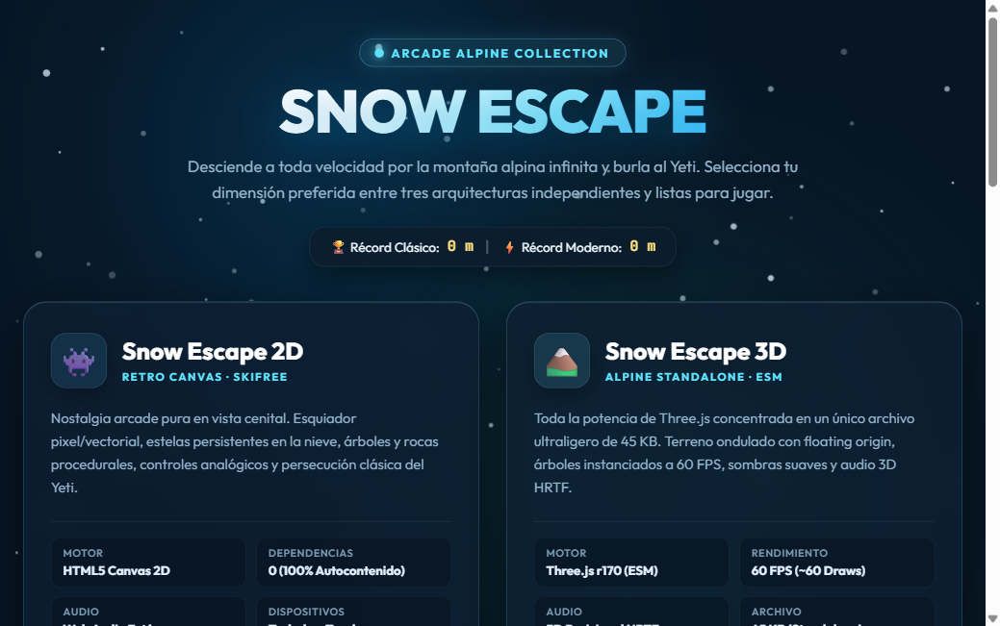
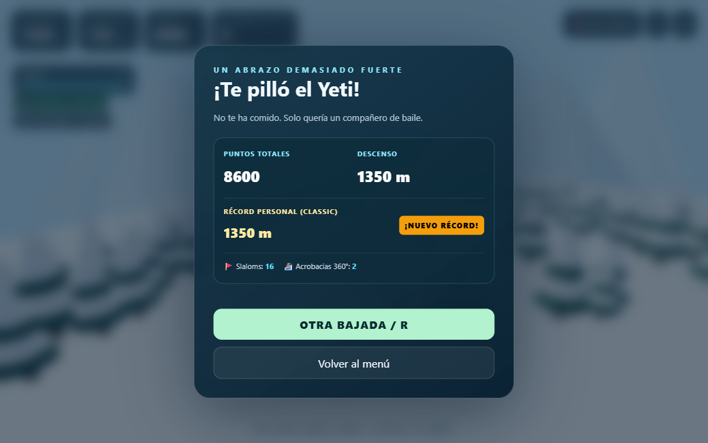
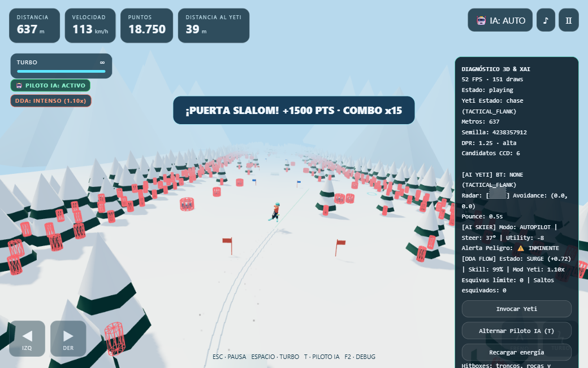
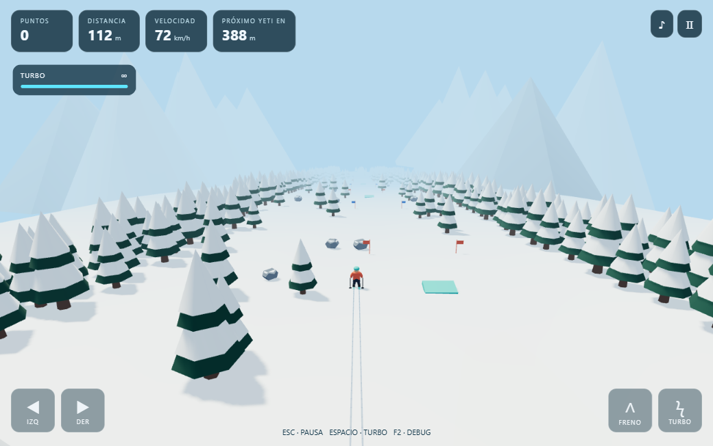
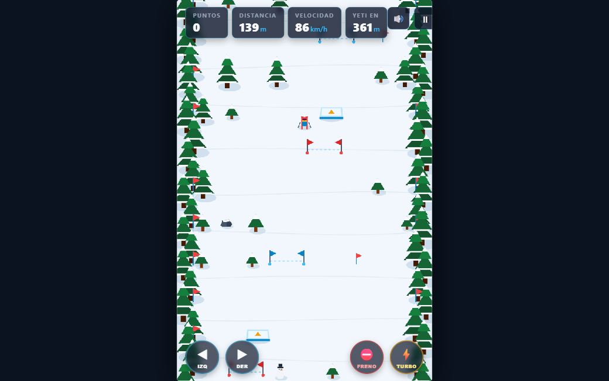
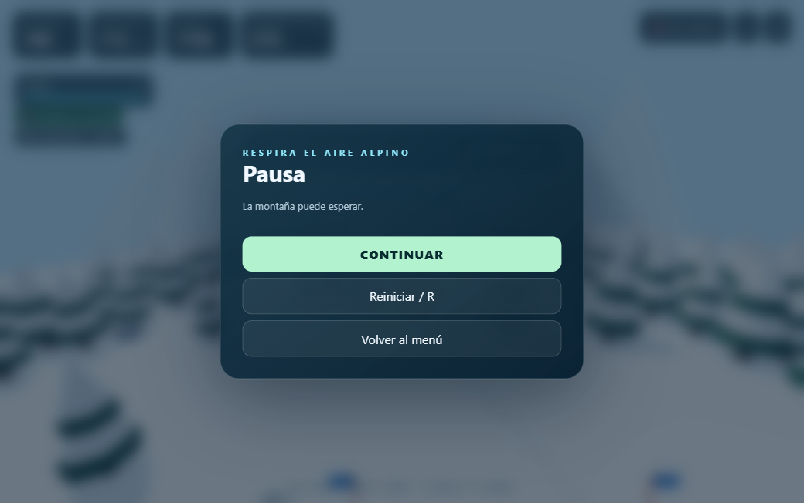

# 🦦 Otter Escape: Yeti Chase — Suite Completa de Videojuegos Alpinos

[](.github/workflows/ci.yml)
[](tests)
[](https://nodejs.org/)
[](https://threejs.org/)
[](https://vitejs.dev/)
[](Dockerfile)
[](docs/CONTROLS.md)
[](CONTRIBUTING.md)
[](LICENSE)

Suite de videojuegos arcade de esquí infinito inspirada en la mística clásica de *SkiFree*, protagonizada por una intrépida **Nutria Esquiadora** equipada con casco dorado, bufanda ondeante al viento, esquís dobles y cola dinámica que se balancea en cada curva, perseguida por el legendario **Yeti de las cumbres**. La suite está modernizada con físicas avanzadas a 60 Hz (objetivo de diseño), audio espacial 3D HRTF y mecánicas acrobáticas. Diseñada con una arquitectura modular de software desacoplada, la suite integra ediciones independientes organizadas en un monorepo profesional y servidas a través de un **Portal Web Unificado**:

1. **🏔️ Portal Hub Alpinos ([`index.html`](index.html)):** Centro de bienvenida con selector de juegos, comparador de motores, cinemática de prólogo, galería de arte y lectura de récords locales.
2. **👾 Otter Escape 2D Retro ([`games/2d-retro/index.html`](games/2d-retro/index.html)):** Arcade clásico 2D en Canvas con slalom, rampas de salto 360°, IA predictiva, alerta visual de proximidad `#yetiAlert`, colisiones AABB y modos Clásico/Moderno.
3. **🎿 Otter Escape 3D Standalone ([`games/3d-standalone/index.html`](games/3d-standalone/index.html)):** Experiencia 3D completa en un único archivo autosuficiente (~51 KB), Three.js por CDN, audio 3D HRTF, alerta visual `#yetiAlert`, física *Swept Circle* y tarjeta de resultados.
4. **⚡ Otter Escape PRO & AI Engine ([`games/3d-pro`](games/3d-pro/)):** Suite modular de alto rendimiento con **Arquitectura de IA Avanzada (Behavior Trees + Piloto Automático Autónomo MPC + Motor DDA de Estado de Flujo + Telemetría XAI + Gizmos 3D)**, Vite 6, Three.js r170, Continuous Collision Detection (CCD) a 60 Hz, Gamepad API y suite de 42 tests unitarios automatizados.
5. **🪰 Drosophila Fly-Brain AI ([`experiments/fly-brain`](experiments/fly-brain/)):** Simulación neurobiológica de la mosca de la fruta (*FlyWire* SNN LIF) que compite en tiempo real como rival en pista (tecla **`B`**). Funciona con servidor WebSocket en Python o con motor local embebido en JavaScript a 60 FPS con arquitectura *zero-allocation*.

---

## 📸 Galería Visual de la Suite

<div align="center">

### 🏔️ Portal Web Hub Unificado


</div>

| ⚡ 3D PRO: Piloto Automático Autónomo MPC | 🔍 3D PRO: Telemetría XAI y Gizmos 3D |
| :---: | :---: |
|  |  |

| 🎿 3D Standalone (Three.js CDN, ~51 KB) | 👾 2D Retro Canvas Arcade |
| :---: | :---: |
|  |  |

| 📊 Scorecard Grid de Resultados | ⏸️ Modal de Pausa con Estado |
| :---: | :---: |
|  |  |

---

## 📖 Guía de Juego: ¿Cómo Jugar?

### 🎯 Objetivo Principal
El objetivo es **descender la mayor distancia posible por la ladera alpina**, esquivando obstáculos (árboles y rocas), cruzando puertas de slalom para multiplicar tu puntuación y aceleración, realizando saltos acrobáticos 360° en rampas de nieve y **escapando del Yeti** cuando baje furioso a perseguirte.

---

### 🕹️ Controles Esenciales

| Acción | ⌨️ Teclado | 🎮 Mando (Xbox / PS) | 📱 Pantalla Táctil | Efecto en la Pista |
| :--- | :---: | :---: | :---: | :--- |
| **Girar / Carve** | `←` / `→` o `A` / `D` | Stick Izquierdo / D-Pad | `◀ IZQ` / `▶ DER` | Trazada lateral con estela de nieve. |
| **Freno en Cuña** | `↑` o `W` | Gatillo `LT` / `L2` | `∧ FRENO` | Desacelera y permite giros cerrados entre pinos. |
| **Acelerar / Tuck** | `↓` o `S` | Inclinar stick abajo | Automático | Adopta postura aerodinámica cuesta abajo. |
| **⚡ Turbo Boost** | **`Espacio`** / `Shift` / `F` | Gatillo `RT` / `R2` o Botón `A` / `✕` | `⚡ TURBO` | Impulso de velocidad máxima (hasta 126 km/h). |
| **⏸️ Pausa** | **`Escape`** | Botón Start / Options | Botón HUD `⏸` | Pausa limpia que congela la simulación. |
| **🤖 Piloto IA (3D PRO)** | **`T`** o `Tab` | Botón `X` / `□` | Botón HUD `🤖 IA` | Alterna: `HUMANO` $\to$ `AUTOPILOT` $\to$ `CO_PILOT`. |
| **🪰 Rival Mosca (3D PRO)**| **`B`** | — | Botón Menú / Debug | Invoca/retira al competidor neuronal biológico. |
| **Reiniciar Pista** | `R` | Botón `Y` / `△` | Botón Menú Reiniciar | Genera una nueva pista con semilla procedural. |
| **Diagnóstico / Gizmos** | `F2` o `` ` `` | Stick Derecho (`R3`) | Botón Debug | Muestra hitboxes 3D, rayos IA y FPS. |

---

### 🎿 Mecánicas de Carrera y Puntuación

1. **Puertas de Slalom (Postes Azul y Rojo):**
   * Pasa entre ambos postes para sumar puntos multiplicados por tu racha (`Combo x1, x2, x3...`).
   * **En Modo Clásico:** Otorga un empujón de aceleración instantáneo (`+3.0 m/s`).
   * **En Modo Moderno:** Recarga inmediatamente el **+25% de tu barra de energía**.
2. **Rampas de Salto Acrobático 360°:**
   * Entra a la rampa con velocidad para impulsarte en un salto parabólico de 2.8 metros de altitud.
   * Mientras estás en el aire, **vuelas inmune por encima de árboles y rocas**.
   * Al completar el giro 360° y aterrizar limpio sobre la nieve, recibes **`+250 PTS`**, una estela explosiva de nieve y un impulso de velocidad.
3. **El Yeti y la Alerta de Proximidad (`#yetiAlert`):**
   * Tras descender la distancia seleccionada (500 m, 1.000 m o 2.000 m), el Yeti despertará con un rugido sísmico.
   * **Alerta Visual y Sonora:** A menos de 65 metros, los bordes de la pantalla palpitan en rojo (`#yetiAlert`) y el latido cardíaco se acelera.
   * **Cómo burlar al Yeti:** Mantén el turbo activo, supera los 90 km/h y encadena slaloms o saltos sin chocar. Si mantienes la distancia durante unos segundos, el Yeti se quedará sin aliento y verás el anuncio **`¡YETI BURLADO!`**.
4. **Modo Clásico vs. Modo Moderno:**
   * **Modo Clásico:** Turbo infinito, pero a máxima velocidad la maniobrabilidad baja al 76% (inercia pura de *SkiFree*).
   * **Modo Moderno:** Turbo táctico con barra de energía (6 s de uso continuo, recarga pasiva en 8 s o instantánea mediante slalom).

---

## 🏛️ Estructura del Repositorio

La suite sigue una estructura modular limpia inspirada en monorepos modernos:

```
Yeti/
├── .github/
│   ├── ISSUE_TEMPLATE/              # Plantillas de issues (bugs, features, config)
│   ├── PULL_REQUEST_TEMPLATE.md     # Checklist de calidad para PRs
│   └── workflows/
│       └── ci.yml                   # Pipeline CI/CD: Matriz Node 20/22 (--workspaces=false)
├── docs/                            # Documentación técnica y especificaciones de arquitectura
│   ├── ARCHITECTURE.md              # Especificación técnica del motor (CCD, BT, MPC, DDA, HRTF)
│   ├── CONTROLS.md                  # Mapeo universal de controles (Teclado, Gamepad API, Touch)
│   ├── DEPLOYMENT.md                # Guía de producción en VPS, Docker, Nginx y Serverless
│   ├── VALIDATION.md                # Certificado de calidad y benchmarks de rendimiento
│   └── screenshots/                 # 📸 Capturas oficiales y material gráfico de la suite
├── games/                           # Ediciones jugables independientes
│   ├── 2d-retro/
│   │   └── index.html               # Edición 2D Retro Canvas autosuficiente con #yetiAlert
│   ├── 3d-standalone/
│   │   └── index.html               # Edición 3D Standalone en un archivo (Three.js CDN, ~51 KB)
│   └── 3d-pro/                      # Edición 3D PRO Modular (Vite 6 + Three.js r170 + AI Suite)
│       ├── package.json             # Manifiesto modular y scripts de prueba
│       ├── vite.config.js           # Empaquetado optimizado (publicDir solo en serve)
│       ├── index.html               # Shell HTML de la edición PRO con avatar compartido
│       ├── tests/                   # Suite de 42 tests unitarios automatizados
│       │   ├── ai.test.js           # Pruebas de Behavior Trees, Lead Pursuit, MPC y DDA (13 tests)
│       │   ├── flybrain.test.js     # Pruebas del rival Drosophila SNN, CCD y Floating Origin (6 tests)
│       │   ├── coherence.test.js    # Coherencia de constantes, safeHalf 4.2 y corredor (3 tests)
│       │   ├── physics.test.js      # CCD, safe corridor (10 km), instanciación y Storage (6 tests)
│       │   ├── ui.test.js           # Alerta de proximidad #yetiAlert, HUD y menú accesible (8 tests)
│       │   ├── entities.test.js     # Nutria (lente, bufanda) y puntos de slalom (3 tests)
│       │   └── build.test.js        # Pruebas del cargador universal postbuild ESM/IIFE (3 tests)
│       ├── src/                     # Código fuente desacoplado en módulos ES
│       ├── scripts/                 # patch-html.js y postbuild.js para soporte file:/// y HTTP
│       └── dist/                    # Bundle de producción (~1.1 MB, sin assets duplicados)
├── tests/                           # Guardias globales de la suite
│   └── suite.test.js                # Validación de enlaces relativos, nginx, alertas y deduplicación (4 tests)
├── experiments/                     # Laboratorio de computación y neurobiología
│   └── fly-brain/                   # Simulación SNN Drosophila LIF + puente WebSocket Python
├── assets/                          # Medios optimizados compartidos (video prólogo e imágenes)
├── index.html                       # 🏔️ Portal Web Hub Unificado
├── jugar.bat                        # 🎮 Lanzador interactivo 1-clic para Windows (Hub / Servidor / Standalone)
├── package.json                     # Orquestador Monorepo (type: module, scripts setup, test y serve)
├── Dockerfile                       # Multi-stage build (Node 22 test+build -> Nginx Alpine ligero)
├── docker-compose.yml               # Orquestación de producción (puerto 8088:80)
├── nginx.conf                       # Servidor Nginx (cabeceras de seguridad + caché selectivo)
├── CHANGELOG.md                     # 📜 Historial de versiones SemVer (Keep a Changelog)
├── CONTRIBUTING.md                  # 🛠️ Guía de contribución y directrices de ingeniería
├── LICENSE                          # ⚖️ Licencia de código abierto MIT
├── SECURITY.md                      # 🔒 Política de seguridad y reporte responsable
├── .editorconfig                    # Reglas universales de formato de código
├── .gitattributes                   # Normalización de saltos de línea (CRLF en .bat, LF en scripts)
└── .gitignore                       # Filtros Git (ignora art/, node_modules/, dist/, repomix)
```

---

## 🏔️ Comparativa de Versiones

| Característica | 👾 2D Retro Canvas | 🎿 3D Alpino Standalone | ⚡ 3D PRO Modular (AI Engine) |
| :--- | :---: | :---: | :---: |
| **Ubicación** | [`games/2d-retro/`](games/2d-retro/index.html) | [`games/3d-standalone/`](games/3d-standalone/index.html) | [`games/3d-pro/`](games/3d-pro/) |
| **Protagonista** | Nutria con casco, bufanda y cola | Nutria 3D con cola oscilante | Nutria 3D articulada PBR |
| **Perseguidor** | Yeti clásico con radar | Yeti 3D acechador | Yeti BTs con Lead Pursuit |
| **Dimensión / Motor** | 2D HTML5 Canvas | 3D WebGL (Three.js CDN, ~51 KB) | 3D WebGL (Three.js r170 empaquetado) |
| **Inteligencia Artificial** | Interceptación predictiva 2D | Lead pursuit + Repulsión | **🧠 Behavior Trees + Piloto IA + DDA Flow** |
| **Piloto Automático (Autopilot)** | — | — | **🤖 MPC Trajectory Rollouts (`T` / `Tab`)** |
| **Rival Biológico (Drosophila)** | — | — | **🪰 Drosophila SNN LIF (`B`)** |
| **Ajuste Dinámico DDA** | Dificultad por distancia | Dificultad por distancia | **📈 Flow State (Alivio / Balance / Oleada)** |
| **Alerta Proximidad (#yetiAlert)**| **✅ Capa visible sobre canvas** | **✅ Capa fija perimetral** | **✅ Capa fija perimetral** |
| **Observabilidad / XAI** | Debug HUD (<kbd>F2</kbd>) | Hitboxes 3D (<kbd>F2</kbd>) | **🔍 Gizmos 3D (Rayos + Retícula + Travesía)** |
| **Puertas de Slalom** | ✅ Velocidad/Energía + Combo | ✅ Velocidad/Energía + Combo | ✅ Velocidad/Energía + Combo |
| **Rampas de Salto 360°** | ✅ Salto sobre obstáculos | ✅ Arco 2.8m + Tuck + Spin | ✅ Arco 2.8m + Tuck + Spin |
| **Soporte de Mandos** | Teclado + Táctil multitouch | Teclado + Táctil multitouch | **✅ Gamepad API (Xbox / PlayStation)** |
| **Audio Espacial** | Síntesis Web Audio estéreo | Síntesis 3D HRTF posicional | Síntesis 3D HRTF + PannerNode |
| **Física de Colisiones** | AABB continua | Swept Circle en cilindros | **Continuous Collision Detection (CCD)** |
| **Resumen de Partida** | Tarjeta de puntos y récord | Tarjeta Scorecard Grid | **Scorecard Grid completo + Badges** |
| **Pruebas Automatizadas** | Pruebas integradas | Validaciones runtime | **✅ Suite de 46 tests nativos (Node.js)** |

---

## 🚀 Inicio Rápido y Comandos Universales

### 🎮 Opción A: Lanzador 1-Clic para Windows
Si estás en Windows, simplemente haz doble clic en [`jugar.bat`](jugar.bat) o ejecútalo en terminal:
```cmd
jugar.bat
```
Te permitirá abrir el **Portal Hub**, iniciar el servidor local de alta velocidad para **Otter Escape PRO**, o abrir las versiones clásicas sin configuración previa.

### 💻 Opción B: Comandos de Terminal (npm workspaces)
Al utilizar **npm workspaces**, puedes ejecutar todos los comandos directamente desde la **raíz del proyecto**:

```bash
# 1. Instalar dependencias limpias de 3D PRO
npm run setup

# 2. Ejecutar la suite completa de 46 tests automatizados (3D PRO + Guardias de Suite)
npm test

# 3. Iniciar entorno de desarrollo interactivo de la edición PRO (Vite HMR)
npm run dev

# 4. Compilar bundle de producción optimizado (Soporte universal file:/// y HTTP)
npm run build

# 5. Servir la suite completa en http://localhost:4173/
npm run serve
```

---

## 🐳 Despliegue en Servidores / VPS con Docker

El proyecto incluye soporte nativo para contenedores de producción ultraligeros con **Nginx Alpine**:

```bash
# Construir imagen y levantar servicio en segundo plano
docker compose up -d --build

# El juego estará disponible en:
# http://TU_IP_O_DOMINIO:8088/ (o el puerto configurado en docker-compose.yml)
```

Para más detalles sobre despliegue con Nginx nativo o plataformas como Cloudflare Pages, consulta [**`docs/DEPLOYMENT.md`**](docs/DEPLOYMENT.md).

---

## 🪰 Experimento Neurobiológico Drosophila SNN

La suite incorpora una simulación neurobiológica de la red neuronal de la mosca de la fruta (*Drosophila melanogaster*) que actúa como esquiador rival autónomo con dinámica **Leaky Integrate-and-Fire (LIF)**:

* **Doble Motor:** Opera de forma local a 60 Hz en JavaScript (con memoria pre-asignada *zero-allocation*) o conectado mediante WebSocket a un servidor puente en Python (`ws://127.0.0.1:8765`).
* **Activación Inmediata:** Presiona **`B`** en la edición 3D PRO para invocar o retirar al rival en cualquier momento.
* **Telemetría en Vivo:** Presiona **`F2`** para ver el conteo de picos neuronales sensoriales, motores y de escape (*Giant Fiber*).
* **Guía Completa de Uso e Integración:** Consulta [**`experiments/fly-brain/README.md`**](experiments/fly-brain/README.md) para detalles matemáticos, esquemas JSON y ejemplos de código.

---

## 📚 Documentación Técnica Detallada

* 🎮 [**Guía Universal de Controles, Física y Modos**](docs/CONTROLS.md)
* 🧠 [**Arquitectura de IA, Behavior Trees y Físicas CCD**](docs/ARCHITECTURE.md)
* 🪰 [**Experimento Drosophila Fly-Brain AI**](experiments/fly-brain/README.md)
* 🚀 [**Guía de Despliegue en Producción (Docker / Nginx)**](docs/DEPLOYMENT.md)
* 📋 [**Certificado Técnico y Benchmark de Calidad**](docs/VALIDATION.md)
* 🛠️ [**Guía de Contribución & Estándares de Código**](CONTRIBUTING.md)
* 📜 [**Registro de Cambios (Changelog)**](CHANGELOG.md)
* 🔒 [**Política de Seguridad**](SECURITY.md)
* ⚖️ [**Licencia MIT**](LICENSE)
