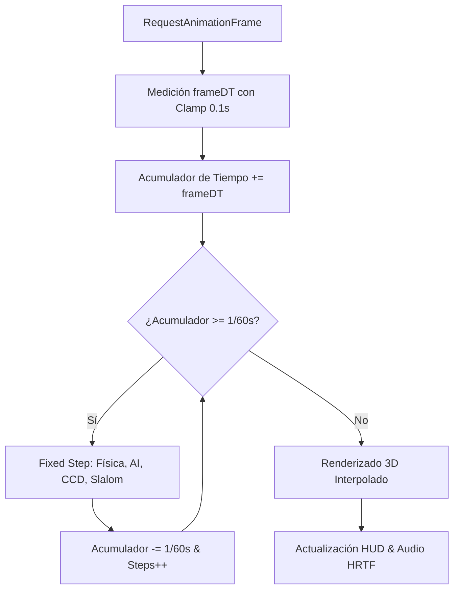

# ⛷️ Otter Escape PRO (Yeti Chase) — Especificación de Arquitectura de Software & AI Suite

[](https://threejs.org/)
[](https://vitejs.dev/)
[](https://nodejs.org/)
[](../tests)
[](../games/3d-pro/src/ai)
[](CONTROLS.md)
[](../LICENSE)

Versión modular y de grado de producción del videojuego alpino de esquí procedural infinito. Desarrollada con **Three.js r170**, empaquetada con **Vite 6** mediante code-splitting optimizado, físicas deterministas desacopladas a 60 Hz con **Continuous Collision Detection (Swept CCD)**, audio espacial 3D HRTF, soporte completo de **mandos de consola** y una **Arquitectura de Inteligencia Artificial (Behavior Trees jerárquicos, Agente Esquiador Autónomo MPC, Motor DDA de Estado de Flujo y Gizmos XAI 3D)**.

---

## 🏛️ 1. Arquitectura de Simulación & Bucle de Juego

El motor implementa un bucle desacoplado donde la física y la lógica de simulación son estrictamente independientes de la tasa de refresco visual del monitor (FPS):



### Características del Motor de Simulación:
- **Paso Fijo (Fixed Timestep 60 Hz):** Implementado en [`main.js`](../games/3d-pro/src/main.js) mediante un acumulador temporal constante (`fixedDT = 1/60 s`). Garantiza aceleraciones, derrapes y físicas reproducibles sin importar si la pantalla es de 60 Hz, 144 Hz o sufre caídas de fotogramas.
- **Protección contra Spiral of Death:** El acumulador descarta tiempo excesivo si el delta supera 0.1 s (por ejemplo, al volver de una pestaña inactiva), impidiendo teletransportaciones o saltos descontrolados.
- **Continuous Collision Detection (Swept CCD):** En [`CollisionSystem.js`](../games/3d-pro/src/physics/CollisionSystem.js), el motor proyecta el segmento de desplazamiento entre $(x_{t-1}, d_{t-1})$ y $(x_t, d_t)$ contra cilindros de radio estricto (`r = 0.38 * escala`). Elimina el fenómeno de *tunneling*, evitando atravesar troncos a 35 m/s.
- **Hitboxes Justas y Tolerantes:** Las zonas de colisión se restringen al tronco macizo de los pinos y la masa de roca, ignorando por completo la silueta de ramas y hojas.

---

## ⚖️ 2. Balance Jugable y Coherencia de Modos

### Modos de Juego Clarificados
1. **Modo Clásico (Turbo Ilimitado con Inercia):**
   - El Turbo Boost puede activarse indefinidamente con <kbd>Espacio</kbd>.
   - **Contrapartida de Habilidad:** A velocidad de turbo (35 m/s), la autoridad de giro lateral se reduce al 76% (`turnAuthority = 0.76` en [`Player.js`](../games/3d-pro/src/entities/Player.js)). Mantener el turbo pulsado reduce la maniobrabilidad, forzando al jugador a soltarlo o aplicar el freno en cuña para no derrapar contra los pinos.
   - **Recompensa de Slalom:** Al no requerir recarga de energía, cruzar puertas otorga un **impulso de velocidad instantáneo** (`+3.0 m/s`) y puntos multiplicados por combo (`150 * combo`).
   - **HUD:** Muestra **`Turbo ∞`** con barra cian estática, eliminando falsas expectativas de agotamiento.

2. **Modo Moderno (Gestión Táctica de Estamina):**
   - Barra de turbo con capacidad para 6 segundos continuos; recarga pasiva completa en 8 segundos.
   - **Recompensa de Slalom:** Cruzar una puerta recarga inmediatamente el **+25% de la barra de energía** y suma `+100 * combo` puntos.
   - **HUD:** Muestra medidor porcentual dinámico (`0% - 100%`) con cambio de color de alerta cuando la energía baja del 23%.

### Dinamismo del Indicador del Yeti en HUD
El HUD desacopla la fase previa de la fase de persecución activa:
- **Pre-aparición:** `EL YETI APARECE EN: [X] m` (cuenta atrás hasta la cumbre).
- **Persecución Activa:** `EL YETI ESTÁ A: [X] m` (separación real en metros con respecto al perseguidor).
- **Escape Exitoso:** `¡YETI BURLADO!` (aviso de descarte con fanfarria de victoria).

### Resumen de Resultados al Finalizar (Scorecard Grid)
En el Game Over se presenta un panel completo con:
- Puntos Totales acumulados.
- Distancia recorrida en metros.
- Récord personal por modo (`CLÁSICO` o `MODERNO`) con distintivo dorado `¡NUEVO RÉCORD!`.
- Puertas de Slalom superadas (`🚩 Slaloms`).
- Acrobacias 360° completadas (`🏂 Acrobacias 360°`).

### Tono Consistente y Amigable
Se unificó la narrativa en todas las ediciones: el Yeti no es un monstruo sangriento, sino una criatura solitaria que busca un compañero de baile: *"¡Un abrazo alpino demasiado fuerte te sacó de la pista! No te ha comido: solo quería un compañero de baile."*

---

## 🧠 3. Arquitectura de Inteligencia Artificial

### A. Framework de Behavior Trees (`games/3d-pro/src/ai/BehaviorTree.js`)
Motor jerárquico *zero-allocation* optimizado para ejecución a 60 Hz con soporte de nodos compuestos y decoradores:
- `Selector`: Evalúa hijos en orden de prioridad hasta que uno retorne `SUCCESS` o `RUNNING`.
- `Sequence`: Ejecuta pasos dependientes en serie hasta que uno retorne `FAILURE` o `RUNNING`.
- `Condition` & `Action`: Nodos hoja de evaluación ambiental y despacho de órdenes cinemáticas.
- `Inverter`: Invierte la polaridad lógica de salida.

### B. Yeti Táctico y Radar Sensorial (`games/3d-pro/src/ai/YetiAI.js`)
- **Radar de 5 Bigotes (Whiskers):** Raycasts sensoriales dinámicos que escanean árboles y rocas a 45°, calculando vectores de fuerza repulsiva para evitar colisiones torpes.
- **Interceptación Predictiva (Lead Pursuit):** Resuelve vectorialmente el punto de encuentro futuro $\vec{p}_{lead} = \vec{p}_p + \vec{v}_p \cdot \tau$.
- **Anticipación de Slalom:** Detecta giros alternados en zig-zag y recorta hacia el centro del corredor alpino.
- **Ataque Acrobático en Salto (Pounce Leap):** A menos de 8.5 m, el Yeti se lanza en un salto parabólico de 1.85 m con aceleración $+42\%$, superando obstáculos terrestres.

### C. Agente Esquiador Autónomo (`games/3d-pro/src/ai/SkierAgentAI.js`)
- **Autopilot por Model Predictive Control (MPC):** Evalúa 7 trayectorias de giro concurrentes simuladas hacia el futuro, maximizando puntuación de puertas de slalom, saltos acrobáticos y distancia con respecto al Yeti y árboles.
- **Modo Co-Piloto:** Permite control manual humano, pero si detecta colisión inminente en $< 0.35$ s, inyecta micro-giros evasivos o frenado automático.
- **Alternancia Dinámica (<kbd>T</kbd> / <kbd>Tab</kbd> / Botón X mando):** Cambia en caliente entre `OFF`, `AUTOPILOT` y `CO_PILOT`.

### D. Dynamic Difficulty Adjustment (`games/3d-pro/src/ai/DDAEngine.js`)
- Implementa el **Canal de Flujo de Mihaly Csikszentmihalyi** con ventana deslizante de 10 segundos.
- Clasifica la experiencia en `ALIVIO (RELIEF)`, `BALANCE (FLOW)` y `OLEADA (SURGE)`, modulando suavemente la velocidad y agresividad del monstruo.

### E. Telemetría XAI & Gizmos 3D (`games/3d-pro/src/ai/AIDebugRenderer.js`)
- Activable mediante <kbd>F2</kbd> o acento grave (<kbd>`</kbd>).
- Renderiza en 3D los conos de visión del Yeti, bigotes sensoriales (verde = despejado, rojo = obstáculo), retícula de intercepción en la nieve y trayectoria planificada del esquiador.

### F. Agente Rival Neurobiológico Drosophila LIF (`games/3d-pro/src/ai/FlyBrainCompetitorAI.js` & `experiments/fly-brain/`)
- **Simulación Neurobiológica Realista:** Basada en el conectoma de la mosca de la fruta (*FlyWire* / *Eon Systems fly-brain*). Modela grupos neuronales específicos con dinámica *Leaky Integrate-and-Fire* (LIF):
  - **LPTC:** Detección de flujo óptico lateral y aproximación de obstáculos a izquierda y derecha.
  - **LPLC2 / Looming:** Despolarización masiva ante peligro frontal crítico inminente.
  - **Central Complex:** Orientación y rumbo hacia las puertas de slalom.
  - **DNa01 / DNa02:** Neuronas motoras de dirección contralateral (`M_R - M_L`).
  - **Giant Fiber (GF):** Disparo de escape de emergencia (salto acrobático 360° o turbo).
- **Arquitectura de Doble Motor (Dual-Engine):**
  - **Servidor Python (PyTorch / WebSocket):** Micro-servicio en `ws://127.0.0.1:8765` para simulación biológica avanzada en Python.
  - **Emulador Local SNN en JavaScript:** Motor LIF embebido a 60 Hz ejecutándose de forma nativa en el navegador con búferes tipados (`Float32Array`) sin dependencias externas.
- **Entidad Física 3D ([`FlyCompetitor.js`](../games/3d-pro/src/entities/FlyCompetitor.js)):** Modelo 3D con cuerpo de quitina, ojos facetados esmeralda, antenas, esquís y un **halo sináptico bioluminiscente** que modula su intensidad en tiempo real según la tasa de disparo de la red neuronal.
- **Activación en Partida:** Conmutable en cualquier instante con la tecla <kbd>B</kbd> o desde el menú de inicio (`🪰 Rival Drosophila`). Telemetría de picos integrada en el panel <kbd>F2</kbd>.

---

## 🌲 4. Generación Procedural & Corredor Seguro Verificado

El sistema de terreno infinito en [`WorldGenerator.js`](../games/3d-pro/src/world/WorldGenerator.js) garantiza una pista orgánica y navegable:

- **Eje de Pista Sinusoidal:** Una función determinista genera el centro de la pista:
  $$\text{corridor}(d) = \sin(d \cdot 0.009) \cdot 11 + \sin(d \cdot 0.023) \cdot 6$$
- **Zona Transitable Garantizada:** La generación rechaza cualquier obstáculo cuya posición horizontal interfiera con el ancho de paso seguro (`safeHalf = 4.2 m`).
- **Validación Automatizada de Semillas:** La suite de pruebas unitarias ([`physics.test.js`](../games/3d-pro/tests/physics.test.js) y [`coherence.test.js`](../games/3d-pro/tests/coherence.test.js)) simula **100 semillas procedurales a lo largo de 10 kilómetros de descenso continuo**, certificando que nunca se generen bloqueos inevitables ni puertas imposibles.

---

## ⚡ 5. Rendimiento Gráfico y Gestión de Memoria

1. **Object Pooling Estricto:**
   - 720 ranuras de huellas de esquí en nieve prealocadas en buffers tipados.
   - 650 partículas de nieve spray operando con `DynamicDrawUsage` y punteros circulares en [`SnowTracks.js`](../games/3d-pro/src/world/SnowTracks.js).
   - Cero llamadas a `new THREE.Mesh` o instanciación de materiales en el bucle principal.

2. **Renderizado Instanciado (`THREE.InstancedMesh`):**
   - Agrupación por geometría y material para pinos, rocas, banderas y rampas.
   - Mantiene las llamadas de dibujo (**Draw Calls**) entre **14 y 22 llamadas por fotograma**.

3. **Calidad Gráfica Adaptativa con Histéresis:**
   - Monitorea FPS de forma continua con objetivo de 60 FPS. Si caen por debajo de 47 FPS durante más de 5 segundos sostenidos, reduce el *Device Pixel Ratio* en 0.2 (mínimo 0.85); si además caen por debajo de 38 FPS, desactiva las sombras dinámicas y pasa a calidad ligera, evitando oscilaciones visuales erráticas.

4. **Almacenamiento Seguro sin Fallos:**
   - Encapsulado en [`StorageManager.js`](../games/3d-pro/src/core/StorageManager.js). Si `localStorage` está bloqueado por directivas de privacidad del navegador o corrupto, conmuta a memoria sin lanzar excepciones no controladas.

---

## 📦 6. Pipeline de Empaquetado & Compatibilidad Universal (`file:///` y `http://`)

Para garantizar que el juego funcione sin fricción tanto en servidores web tradicionales como al abrir directamente el archivo HTML en Windows mediante doble clic (`file:///`), la arquitectura implementa una estrategia de empaquetado dual y post-procesado:

1. **Problema de Protocolo `file:///` en Navegadores Modernos:**
   - Los navegadores basados en Chromium tratan el protocolo `file:` con origen nulo (`Origin: null`), bloqueando por CORS las hojas de estilo externas (`<link rel="stylesheet" crossorigin>`) y los módulos ES6 nativos (`<script type="module">`).
2. **Solución Implementada:**
   - **Vite 6 (ESM):** Genera el bundle de producción moderno con code-splitting para servidores HTTP.
   - **esbuild (IIFE Standalone):** Genera un bundle autocontenido (`app.iife.js`, ~552 KB) que no depende de `type="module"`.
   - **Script Postbuild ([`scripts/postbuild.js`](../games/3d-pro/scripts/postbuild.js)):**
     - Inyecta el CSS compilado como bloque `<style>` inline en el `<head>`, garantizando la aplicación inmediata de la estética alpina sin peticiones de red.
     - Inserta un cargador universal que detecta `location.protocol === 'file:'` y carga `app.iife.js`, o conmuta al bundle ESM en entornos HTTP.

---

## 📁 7. Mapa de Módulos del Proyecto

```
games/3d-pro/
├── index.html                   # Shell HTML accesible y semántico
├── vite.config.js               # Empaquetado y code-splitting
├── package.json                 # Manifiesto y scripts npm (v4.5.0-ai)
├── scripts/
│   └── postbuild.js             # Inyección CSS inline y cargador universal
├── tests/                       # Suite de 37 tests unitarios (Node.js nativo)
│   ├── ai.test.js               # Tests de Behavior Trees, Lead Pursuit y DDA (13 tests)
│   ├── flybrain.test.js         # Tests de dinamica neuronal LIF Drosophila (4 tests)
│   ├── coherence.test.js        # Tests de coherencia de configuración, safeHalf 4.2 y corredor (3 tests)
│   ├── physics.test.js          # Tests de CCD, corredor seguro 10km, instanciación y Storage (6 tests)
│   ├── ui.test.js               # Tests de alerta de proximidad, HUD y menú accesible (8 tests)
│   └── entities.test.js         # Tests de la nutria (lente, bufanda) y puntos de slalom (3 tests)
└── src/
    ├── main.js                  # Orquestador del juego y state machine
    ├── config.js                # Fuente única de verdad: constantes físicas, corridor y validación
    ├── styles.css               # Diseño moderno, HUD de cristal y overlays
    ├── ai/                      # Motor de IA Avanzada
    │   ├── BehaviorTree.js      # Framework jerárquico BT
    │   ├── YetiAI.js            # Tácticas del Yeti y bigotes
    │   ├── SkierAgentAI.js      # Autopilot MPC y Co-Pilot
    │   ├── FlyBrainCompetitorAI.js # Controlador Rival SNN Drosophila (Dual-Engine)
    │   ├── DDAEngine.js         # Ajuste dinámico de dificultad
    │   ├── AITelemetry.js       # Registro de métricas XAI
    │   └── AIDebugRenderer.js   # Gizmos 3D de depuración
    ├── core/                    # Núcleo de motor y hardware
    │   ├── Engine.js            # Bucle desacoplado 60 Hz, FPS con histéresis y calidad adaptativa
    │   ├── AudioManager.js      # Síntesis Web Audio y HRTF sin fugas de nodos
    │   ├── InputManager.js      # Teclado, Gamepad API y Táctil multitouch
    │   └── StorageManager.js    # Persistencia segura en memoria / localStorage
    ├── entities/                # Actores 3D
    │   ├── Player.js            # Cinemática del esquiador, turbo y saltos
    │   ├── Yeti.js              # Rig jerárquico 3D y cinemática del Yeti
    │   ├── FlyCompetitor.js     # Rival insectoide con halo sináptico 3D
    │   └── ProceduralModels.js  # Fábrica geométrica procedural
    ├── physics/                 # Motor físico
    │   └── CollisionSystem.js   # Continuous Collision Detection (Swept CCD)
    ├── world/                   # Generación procedimental y entorno
    │   ├── WorldGenerator.js    # Generación de bloques, corredor seguro (safeHalf=4.2m) y puertas
    │   ├── MountainTerrain.js   # Terreno continuo y elevaciones
    │   ├── ObstaclePool.js      # Pooling instanciado de árboles, rocas y rampas
    │   └── SnowTracks.js        # Partículas de nieve y huellas en búferes circulares
    └── ui/                      # Presentación visual
        ├── HUD.js               # Telemetría en tiempo real, medidor de energía y badges IA
        └── MenuManager.js       # Menús modales, accesibilidad y Scorecard Grid
```
